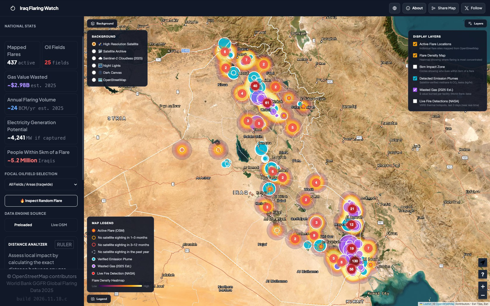
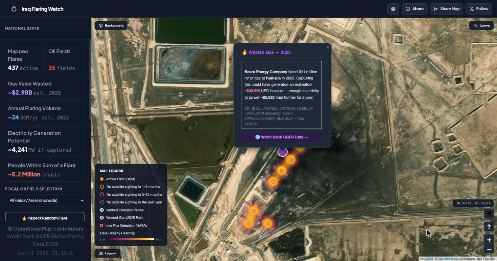
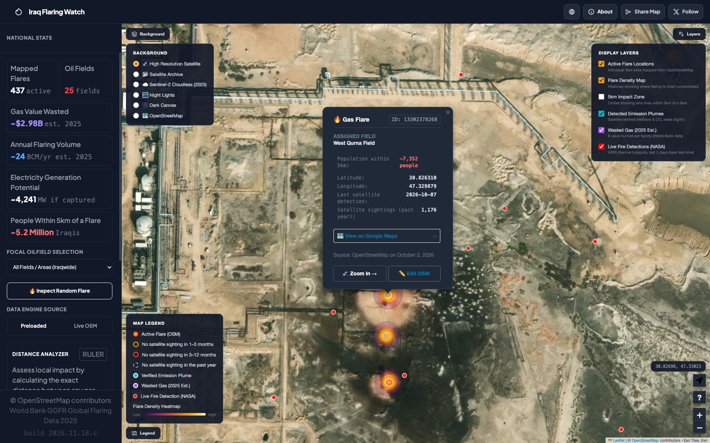
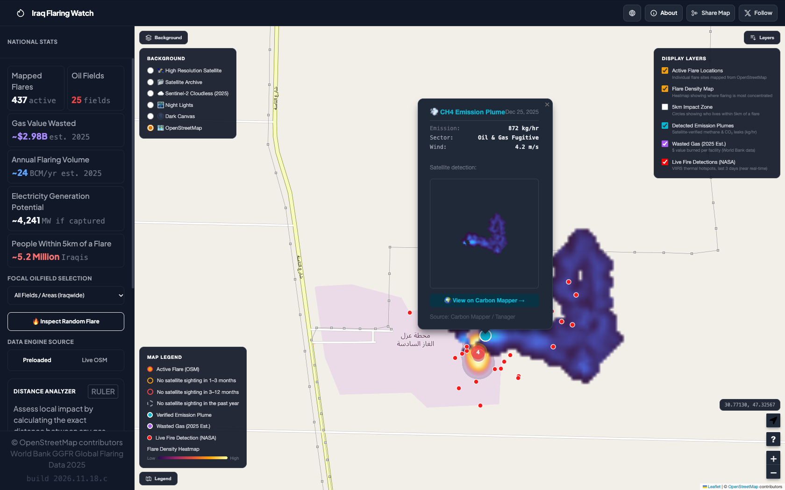

# 🔥 Iraq Flaring Watch

An open-source, serverless web map tracking gas flaring across Iraq — combining satellite detections, economic analysis, and community exposure data in a single interface.

**Live:** [iraqflaringwatch.com](https://iraqflaringwatch.com)

---

## What it shows 

Gas flaring burns off associated natural gas during oil extraction rather than capturing it. Iraq is one of the world's largest gas flaring nations. This tool makes that visible.

**Four data layers:**

- 🟠 **Active flare sites** — crowdsourced from OpenStreetMap, with population estimates for people living within 5km
- 🟣 **Economic waste** — World Bank GGFR 2025 volume estimates, sized by annual gas burned, with USD value lost and Iraqi homes that could have been powered
- 🔵 **Emission plumes** — verified CH₄ and CO₂ detections from Carbon Mapper's Tanager satellite, with emission rates in kg/hr
- 🔴 **Live fire detections** — NASA FIRMS VIIRS thermal detections from the past 3 days (NOAA-20 and NOAA-21 satellites), with detection time, confidence and fire radiative power

---

## Screenshots

### National Overview
All layers active — flare clusters, emission plumes, economic waste bubbles, and density heatmap across Iraq's oil fields.



### Economic Waste — Wasted Gas Popup
Click any purple bubble to see annual gas volume (World Bank GGFR 2025), estimated USD value lost, and Iraqi homes that could have been powered.



### Active Flare Inspection
Zoom into any flare on satellite imagery to see population within 5km, coordinates, and direct links to Google Maps and OSM editor.



### Emission Plume — OpenStreetMap Background
CO₂ and CH₄ plumes detected by Carbon Mapper's Tanager satellite, shown with emission rate in kg/hr and satellite detection image.



---

## Features

- **Background maps** — Esri World Imagery, Esri Clarity archive, EOX Sentinel-2 cloudless, NASA night lights, Esri dark canvas, and OpenStreetMap
- **Night lights from a recent night** — NOAA-20 VIIRS Day/Night Band imagery from the most recent night when the moon was down, so flares and city lights stand out (picked automatically from the lunar cycle and checked against the imagery)
- **Satellite activity status** — each flare popup shows when NASA VIIRS last detected it burning and how often over the past 12 months; flares not seen recently get a coloured ring
- **Flare density heatmap** — visualise concentration across Iraq's oil fields
- **5km impact zone** — toggle safety radius buffers around each flare
- **Distance Analyzer** — geodesic ruler to measure proximity between any flare and a community
- **Share links** — every zoom, layer state, and background is encoded in the URL for instant sharing
- **Location finder** — jump to your current location to assess nearby flaring
- **Inspect Random Flare** — explore the dataset at random
- **Live OSM mode** — query the OpenStreetMap Overpass API in real time for latest data
- **One-click OSM editing** — direct link to iD editor to add or update flare data
- **National stats sidebar** — live economic and health impact statistics
- **Population impact layer** — 5.2 million Iraqis within 5km of a flare, calculated using WorldPop raster with non-overlapping union methodology
- **Base map switcher** — accessible directly on map canvas for mobile users
- **Coordinate display** — shows lat/lon at zoom ≥ 13
- **English and Sorani Kurdish** — full right-to-left Kurdish interface, translated by the community on Weblate
- **Follow:** [@IraqFlaring](https://twitter.com/IraqFlaring) on X/Twitter

---

## Data sources

| Layer | Source | Coverage |
|---|---|---|
| Flare locations | [OpenStreetMap](https://www.openstreetmap.org) | Live / preloaded |
| Population (5km) | [WorldPop Project](https://www.worldpop.org) | 2020 UN-adjusted |
| Emission plumes | [Carbon Mapper / Tanager](https://carbonmapper.org) | 2024–2025 |
| Gas volumes & economics | [World Bank GGFR](https://www.worldbank.org/en/programs/gasflaringreduction/global-flaring-data) | 2012–2025 (2025 shown) |
| Live fire detections | [NASA FIRMS](https://firms.modaps.eosdis.nasa.gov) — VIIRS NOAA-20 / NOAA-21 | Last 3 days |
| Flare activity status | NASA FIRMS — VIIRS archive | Trailing 12 months, refreshed quarterly |
| Satellite imagery | Esri, EOX (Sentinel-2 cloudless), NASA GIBS (NOAA-20 VIIRS night lights) | Various |

---

## Economic methodology

Wasted gas value is estimated at **$3.50/MMBtu** (conservative global benchmark).

```
Value (USD millions) = vol_mm3 × 35,315 MMBtu/M m³ × $3.50 / 1,000,000
```

Electricity equivalent assumes **35% plant efficiency** and **5,000 kWh/household/year** (IEA 2024 × Iraq 2024 census, reviewed by Ahmed Gailani, Senior Energy Modeller at NESO). The 35% efficiency applies to both the national MW figure and the per-site homes figure:

```
MW potential = (vol_mm3 × 4,400 × 0.35) / 8,760
Homes        = (vol_mm3 × 4,400 × 0.35 × 1,000) / 5,000
```

Full details in [DATA_METHODOLOGY.md](DATA_METHODOLOGY.md).

---

## Self-hosting

Fully serverless — no backend required.

1. Fork this repository
2. Go to Settings → Pages → set source to `main`
3. Your instance will be live at `https://<username>.github.io/<repo>/`

For a custom domain, add a `CNAME` file to the repo root containing your domain name, then point your DNS A records to GitHub's IPs.

---

## Contributing

If a flare is missing from the map, add it to OpenStreetMap:

| Tag | Value |
|---|---|
| `man_made` | `flare` |

---

## Translations

Iraq Flaring Watch is being translated into Arabic and Sorani Kurdish by the community using [Weblate](https://weblate.org/), a libre web-based translation platform.

You can contribute translations — no coding required — at our Weblate project:
**[hosted.weblate.org/projects/iraq-flaring-watch](https://hosted.weblate.org/projects/iraq-flaring-watch/)**

Translation files live in the `locales/` directory (`en.json` is the source of truth).

[](https://hosted.weblate.org/engage/iraq-flaring-watch/)


## License & attributions

- Code: MIT License
- Map data: © OpenStreetMap contributors (ODbL)
- Population: WorldPop Project
- Basemaps: Esri, Earthstar Geographics, EOX (Sentinel-2 cloudless, modified Copernicus data), NASA GIBS
- Fire detections: NASA FIRMS
- Plumes: Carbon Mapper / Tanager
- Gas volumes: World Bank GGFR
- Translations: powered by [Weblate](https://weblate.org/) (libre hosting)

