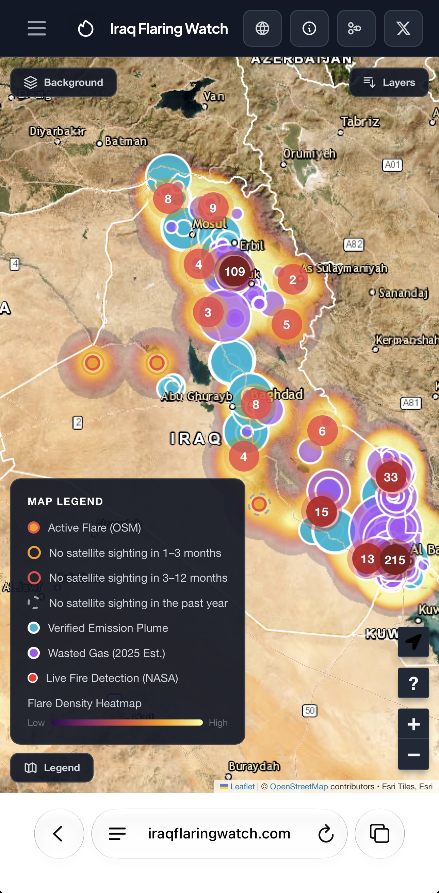
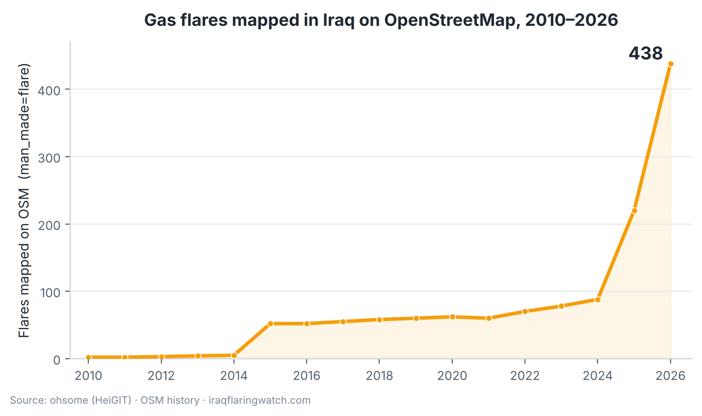

Every night across southern Iraq, hundreds of gas flares burn over some of the largest oil fields on earth. They torch associated gas that could light millions of homes — in a country where those same homes get a few hours of grid power a day and the rest from diesel generators. The gas is burned because capturing it was never built. The flames are visible from space, yet on the ground almost no one is counting them.

So I built [Iraq Flaring Watch](https://iraqflaringwatch.com) to count them in public — a live map of Iraq's flaring, what it's wasting, and who it's affecting. This diary is about how it came together, and why OpenStreetMap ended up at the centre of it.

## What it is

Iraq Flaring Watch is a single-page map that pulls open scientific data together in one place:

OpenStreetMap
: the flare locations themselves — every flare on the map is an OSM `man_made=flare` node, so what you see is what mappers have put on OSM. There are two modes: a **preloaded** layer (a saved Overpass snapshot committed to the repo) that keeps load off Overpass and gives me a stable baseline to spot vandalism against, and a **Live OSM** option that pulls the current data straight from Overpass in real time.

NASA FIRMS (VIIRS)
: near-real-time satellite fire detections, so you see what the satellites saw in the last few days, not a static snapshot.

Carbon Mapper
: satellite methane and CO₂ plume detections (Tanager), showing which flares are leaking as well as burning.

World Bank
: global flaring data, for the volumes and the national baseline.

WorldPop
: the population raster, intersected with flare buffers to estimate the people living within 5 km of a flare.

Leaflet.js
: the open-source engine that draws it all, with no proprietary basemap and no API gatekeeper.

Not one of those sent me an invoice. A single person, working evenings, can take open satellite data, open demographic rasters and open economic datasets, put them on an open map, and hold an oil industry's waste up to daylight. That's the part that still amazes me.

## Where OSM comes in

Building the map made me confront how blank Iraq's industrial layer is on OSM. Some of the largest oil fields on earth sit in the south, and large stretches of them are, on the map, empty desert. Gas-processing plants, flare stacks, oil gathering stations, storage depots — huge, permanent installations — simply aren't there.

Iraq Flaring Watch turned out to be the perfect fix for that, because a persistent flare is a facility announcing its own coordinates every night. So the project became a mapping engine as much as a monitoring one:

1. A flare shows up as a persistent hotspot over a spot OSM thinks is bare.
2. I cross-check it against what's already mapped. **OpenInfraMap** is my first lens — it renders OSM's power and oil/gas layer beautifully, so I can see at a glance whether anything near the flare already exists. **Overpass Turbo** is the audit next to it, querying the area to see exactly what's tagged and how.
3. I open the spot in satellite imagery, find the facility that's obviously there, and trace it into OSM — or fix what's already there and mistagged.

The flaring data and OSM correct each other: the fires point me at infrastructure to map, and the infrastructure I map turns an anonymous heat signature into a named, located, correctly-tagged thing anyone can use.

You can see the effect in OSM's own history. The number of flares tagged `man_made=flare` in Iraq sat in the low tens for years; through the Iraq Flaring Watch work it has climbed to **438** today, and most of that recent jump is flares I traced after a satellite detection pointed me at them.

*Count of `man_made=flare` within Iraq over OSM history. Source: ohsome (HeiGIT).*

## Open all the way through

I could have kept this private. But a flaring map built on a proprietary basemap and a closed dataset is a dead end — nobody can check it, nobody can extend it, and the day I stop maintaining it, it's gone. So the project is open at every layer:

- The **data in** is open — OSM (the flare locations themselves, via Overpass), NASA FIRMS, Carbon Mapper, World Bank and WorldPop.
- The infrastructure I discover goes **into OSM**, the one layer I contribute back to and the one that outlives the project. A gas-processing plant or gathering station I add because of a flare detection is there for a transport mapper, a humanitarian team, an air-quality study, an OpenInfraMap user — whoever needs it next.
- The **code out** is open too. Iraq Flaring Watch is on GitHub under the **MIT licence** at [github.com/rawazrauf/iraq-flaring-watch](https://github.com/rawazrauf/iraq-flaring-watch). The map itself is a serverless `index.html` — no backend; it reads OSM flares either from a preloaded Overpass snapshot or live from Overpass — but behind it sits a small pipeline of open queries I wrote to turn raw data into the figures on the map. A Google Colab script buffers every flare by 5 km, clips the WorldPop raster and sums the population to get who lives nearby; another script pages the Carbon Mapper API for Tanager methane and CO₂ plume detections over Iraq; a notebook matches NASA VIIRS fire detections to individual flares; and the World Bank GGFR volumes feed the national economics. Every query, and every JSON output it produces, is committed to the repo, so the whole chain from open data to published number is auditable and reproducible — not a black box.
- There's nothing Iraq-specific about the machinery. Swap the bounding box and the national figures and the same stack becomes Flaring Watch for Nigeria, Libya, Algeria, Turkmenistan — anywhere gas is burning and nobody's counting. If you want to stand one up for your country, please do; that's what the licence is for.

## How you can help

Iraq's energy infrastructure is one of the most under-mapped layers anywhere, and there's a clear, high-impact order to work in. If you map in Iraq — or want to — here's where to start:

1. **Add `man_made=flare` for flares that aren't mapped yet.** Iraq Flaring Watch shows you exactly where they're burning; cross-check against satellite imagery and OpenInfraMap, then tag the flare stacks that are still missing. This is the single most useful thing, and the chart above is literally the scoreboard.
2. **Add `industrial=wellsite` polygons around existing `man_made=petroleum_well` points.** Iraq has over 3,000 oil wells mapped as points, but only around 1,000 have their wellsite drawn as a polygon (you can see the gap on OpenInfraMap). Tracing the wellsite footprint around a well point turns a dot into a real, measurable facility.
3. **Add the rest of the missing oil, electricity and water infrastructure.** Open OpenInfraMap over Iraq and fill in what's absent — refineries, gas-processing plants and pipelines on the oil-and-gas side; power plants, substations and transmission lines on the electrical side; treatment and pumping stations on the water side. For the oil and gas facilities, the flare data is a free, precise guide to where to look.

## Take a look

The site is live at [iraqflaringwatch.com](https://iraqflaringwatch.com), and the source is on GitHub under the MIT licence at [github.com/rawazrauf/iraq-flaring-watch](https://github.com/rawazrauf/iraq-flaring-watch) — fork it, adapt it, and point it at your own country.

The fires are easy to see from space. Getting them onto the map is the part that needs mappers.

🔥 **iraqflaringwatch.com**